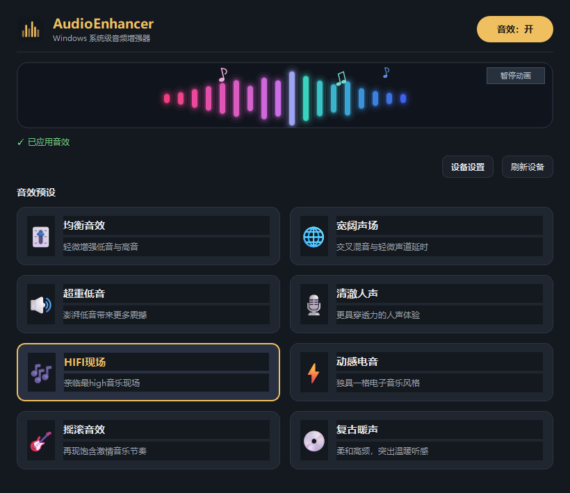

# AudioEnhancer

基于 Equalizer APO 的 Windows 音效预设控制面板。提供 8 种固定 EQ 预设、开关、系统托盘、上次选择记忆，以及可暂停的彩色音柱和漂浮音符动画。音效关闭时动画静止，开启后按四拍节奏跳动；动画不采集或分析系统音频。

## 界面预览



上图是音效开启状态的界面示意。顶部“音效”按钮控制总开关；点击下方任一预设卡片即可切换音效，金色边框标出当前选择。状态文字会显示应用结果或错误。

“设备设置”打开 Equalizer APO 的设备选择器；更换 Windows 默认播放设备后，点击“刷新设备”重新应用当前音效。动画面板右上角可暂停或恢复动画：音效关闭时画面静止，开启后按模拟的四拍节奏跳动。动画只用于视觉反馈，不与播放中的音乐同步。


## 运行要求

- Windows 10/11（x64）、Python 3.10 或更新版本。
- [Equalizer APO](https://sourceforge.net/projects/equalizerapo/) 1.4.2 x64。程序可下载并启动其官方安装包；设备启用需在官方 **Device Selector** 中勾选播放设备，并按提示重启。
- 修改 `C:\Program Files\EqualizerAPO\config\config.txt` 需要管理员权限。请以管理员身份启动 AudioEnhancer。

## 从源码运行

```powershell
py -3 -m venv .venv
.\.venv\Scripts\python.exe -m pip install -r requirements.txt
.\.venv\Scripts\python.exe main.py
```

首次启动后，点击安装或设备设置按钮，启用 Windows 默认播放设备。主界面检测到 APO 主配置后，可点击预设开启音效。更换 Windows 默认播放设备后，点击“刷新设备”以重新应用音效。程序只修改 APO 自动加载的 `config.txt`，并通过 `Device:` 指令限定到应用时的默认播放设备。

首次应用时会在同目录生成 `config.original.txt` 备份。关闭音效或从托盘退出时会恢复原文件。若程序异常终止，备份会保留；重新打开程序并关闭音效或退出即可恢复。若备份丢失，程序会拒绝继续覆盖已有的音效配置。

> 使用期间请勿同时在 Equalizer APO 编辑器中修改 `config.txt`；恢复操作会以启动音效前的备份为准。其他程序可能以独占模式绕过系统 APO，因此不一定受此音效影响。

## 打包与测试

```powershell
.\.venv\Scripts\python.exe -m unittest discover -s tests -v
.\build.bat
```

`build.bat` 会重新创建虚拟环境，按 `AudioEnhancer.spec` 生成 `dist\AudioEnhancer.exe`，并同步覆盖项目根目录的同名 EXE。打包配置会排除环境中可能混入的 Poppler ICU DLL，避免 QtCore 加载失败。构建产物和第三方安装包不应提交到源码仓库。

## 许可证与第三方软件

本项目采用 [GPLv3](LICENSE)。AudioEnhancer 不包含 Equalizer APO 源码或安装包。首次安装时下载官方 1.4.2 x64 安装包，并校验 SHA-256：`7403be7427bbe1936a40dded082829b6e217fc4f5990fee5cba501f0ae055afa`。也可以将同版本官方安装包命名为 `EqualizerAPO_setup.exe`，放在程序旁边使用。Equalizer APO 由其项目以 GPLv2 或后续版本发布；PyQt6 免费版采用 GPLv3。发布二进制时应附上适用的第三方许可信息。

## 代码结构

- `main.py`：Qt 界面、托盘、异步任务队列。
- `apo_manager.py`：APO 安装包校验、主配置备份、写入与恢复。
- `device_enum.py`：Windows 默认播放设备枚举。
- `effects.py`：固定音效参数和 APO 配置生成。
- `music_visualizer.py`：Qt 绘制的音柱与音符动画。
- `settings.py`：本地设置持久化。
- `tests/`：配置和切换行为测试。
